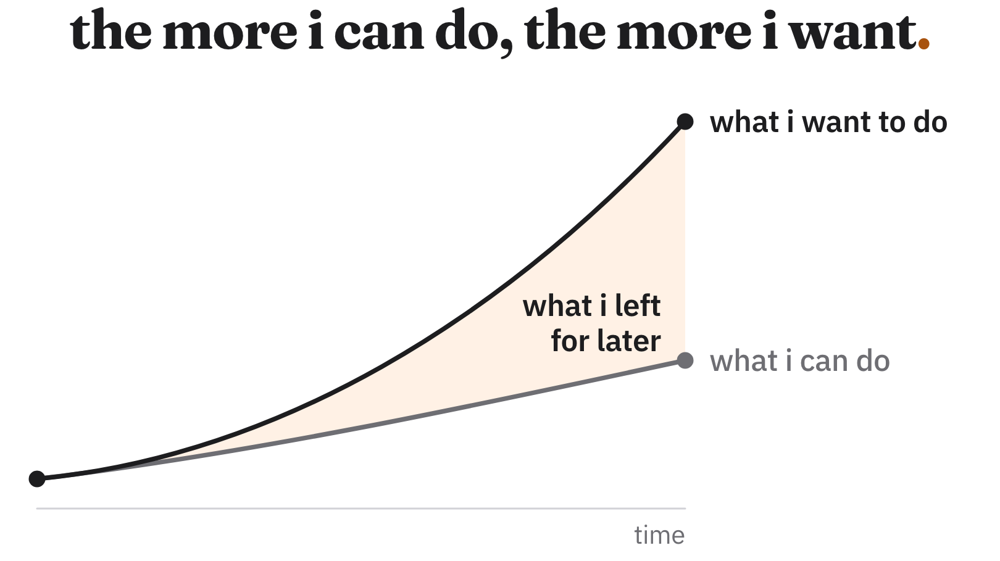

i don't think i've ever been as productive as i am today.

i can do things that, a few years ago, i wouldn't have even considered attempting on my own. ideas that would've taken months of work can now take shape over a weekend.

and that's incredible. genuinely.

ai has given me a kind of freedom i didn't have before. i can experiment more, learn new things, and build projects without having to commit an absurd amount of time to each one.

the cost of trying something has become incredibly low. and so has the cost of giving up.

if i have an idea, i can start building it and quickly figure out whether it's worth pursuing. if i don't like where it's going, i can simply move on to something else. i no longer have to worry so much about the effort i'd be throwing away.

but i've noticed something interesting: the more i can do, the more i want to do.

my ambitions have grown alongside my ability to execute.

and somehow, that has also created more pressure on myself.

sometimes i finish a day having accomplished far more than i would've been able to a few years ago, and i still find myself thinking about everything i didn't have time to do.

it's a strange feeling. i'm happy with what i've managed to build, but at the same time frustrated by everything i've had to leave for another day.

and i don't think it's simply about wanting to work more. there are so many things i'd love to experiment with, so many projects i'd like to bring to life, that finding time for all of them feels impossible.

the funny thing is, i wouldn't trade this freedom for anything. i love being able to start working on an idea without having to make elaborate plans. i love knowing i can build things that used to feel out of reach.

but maybe i still haven't learned how to deal with this new capacity.

for a long time, the effort required to do something also helped me decide whether it was worth doing. now that barrier has almost disappeared, and choosing where to spend my time somehow feels even harder.

i still have the same 24 hours in a day, just with so many more possibilities to fit into them.

and i have a feeling that no matter how productive i become, i'll always find something new i'd like to do with the time i've saved.
