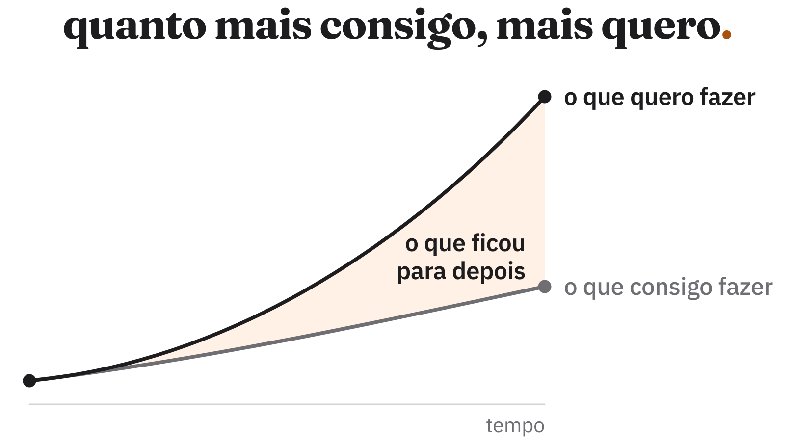

acho que nunca fui tão produtivo quanto sou hoje.

consigo fazer coisas que, há alguns anos, nem consideraria tentar sozinho. ideias que antes exigiriam meses de trabalho agora podem ganhar forma em um final de semana.

e isso é incrível. de verdade.

a ia me deu uma liberdade que eu não tinha antes. consigo experimentar mais, aprender coisas novas e construir projetos sem precisar dedicar uma quantidade absurda de tempo a cada um deles.

o custo de tentar alguma coisa ficou muito baixo. e o de desistir também.

se tenho uma ideia, posso começar a desenvolver e descobrir rapidamente se ela faz sentido. se não gostar do resultado, posso simplesmente partir para outra. não preciso mais pensar tanto no esforço que vou desperdiçar.

só que percebi uma coisa curiosa: quanto mais consigo fazer, mais coisas quero fazer.

minhas ambições cresceram junto com a minha capacidade de executar.

e, de alguma forma, isso também criou uma cobrança interna maior.

às vezes termino um dia em que produzi muito mais do que conseguiria produzir antigamente e ainda fico pensando nas coisas que não tive tempo de fazer.

é uma sensação estranha. estou satisfeito com o que consegui construir, mas ao mesmo tempo frustrado com tudo que ficou para depois.

e não acho que seja uma questão de simplesmente querer trabalhar mais. tem tanta coisa interessante que gostaria de experimentar, tantos projetos que gostaria de tirar do papel, que parece impossível encontrar tempo para tudo.

o mais curioso é que não trocaria essa liberdade por nada. gosto de poder começar uma ideia sem precisar fazer grandes planos. gosto de ter a possibilidade de construir coisas que antes estavam fora do meu alcance.

mas talvez eu ainda não tenha aprendido a lidar com essa nova capacidade.

por muito tempo, o esforço necessário para fazer alguma coisa também ajudava a decidir o que valia a pena fazer. agora essa barreira praticamente desapareceu, e escolher onde colocar meu tempo parece ter ficado ainda mais difícil.

continuo tendo as mesmas 24 horas por dia, só que com muito mais possibilidades dentro delas.

e tenho a impressão de que, por mais produtivo que eu me torne, sempre vou encontrar alguma coisa nova que gostaria de fazer com o tempo que economizei.
