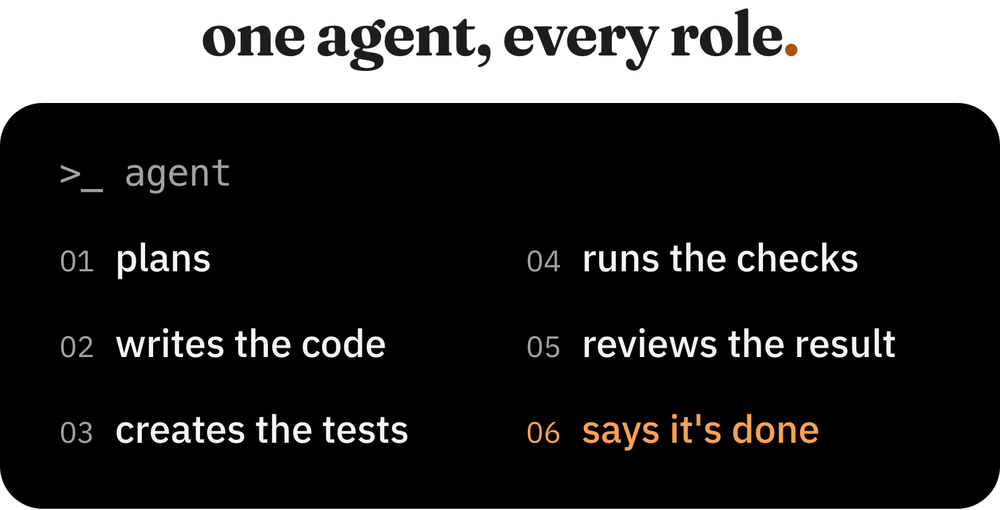

an agent receives a task, plans the implementation, writes the code, creates the tests, runs the checks, reviews the result, and reports that it's done.

there's something odd about that workflow.

peer code review is a common practice in software engineering for a reason. the person who implemented a solution isn't always the best person to spot its flaws. there's a natural bias toward decisions you've just made.

with agents, we're concentrating even more responsibilities in the same place. the model decides how to solve a problem and, quite often, also decides whether it solved it well enough.

that doesn't mean agents are bad at reviewing code. quite the opposite. i use agents for code review and trust that process quite a bit.

what bothers me is relying exclusively on their judgment, including for things that don't require judgment at all.

## are you sure your agent actually ran the tests?

one recurring issue in my workflow has been agents ignoring instructions documented in skills or configuration files.

sometimes i'd ask why a particular step hadn't been executed and get an answer along the lines of "you're right, i skipped that step. that was my mistake."

great that the agent acknowledged it. but what if i hadn't asked?

think about the instructions you've probably added to an `AGENTS.md` or `CLAUDE.md` file:

- run the tests before finishing
- don't disable lint rules
- don't modify files outside the task's scope
- don't make schema changes without approval

how do you know those instructions were followed?

because the agent said it ran the tests? because it gave you a convincing implementation summary? because the instructions explicitly say those steps are mandatory?

the problem is that we're using text to define behaviors that, in many cases, could be enforced by the execution environment itself.

instructions matter. they provide context, establish conventions, and help the model make decisions. i just don't think they should be the only layer of protection for requirements we consider mandatory.

if a rule is important enough to block a delivery, why should enforcing it depend on an llm's interpretation?

## what should be deterministic?

i think this is one of the most important decisions when building a workflow around coding agents.

my preference is simple: **whenever a condition can be checked objectively and reproducibly, i'd rather have that verification implemented in code.**

i don't need a model deciding whether TypeScript compiled successfully. the compiler already answers that.

i don't need it to read through a file and try to identify whether someone disabled a lint rule. i can check that with a script.

i also don't want to depend on an agent remembering to execute a sequence of commands before opening a PR.

what i want is an execution contract: before a change can move forward, a known set of checks must run and pass.

that's different from writing "remember to run all checks" in a prompt.

the agent can still run those commands during development, but approving the change shouldn't depend solely on its claim that it did. an independent pipeline, like CI, can enforce the same checks.

it's important not to confuse determinism with absolute certainty. tests can be flaky, checks can have bugs, and a green pipeline doesn't prove that the software is correct.

the point is to remove unnecessary decisions from the model: which checks to run, which ones to skip, and what counts as an acceptable result.

the criteria are defined before implementation and applied consistently.

## not everything fits into a script

there's a big difference between checking whether tests passed and evaluating whether those tests are any good.

a script can detect whether a test file changed alongside an implementation. it can't conclude from that alone whether the relevant scenarios are covered.

the same applies to architecture.

i can define dependency rules between modules, enforce complexity limits, and check conventions. but how do you automatically decide whether an abstraction actually makes sense for a particular project?

that's where i want the model's judgment.

evaluating alternatives, identifying edge cases, questioning architectural decisions, and finding inconsistencies between the implementation and the task's objective.

these evaluations depend on context and don't always have a single correct answer.

i don't see a reason to turn every engineering decision into a rigid rule. that would create a system that's difficult to maintain, full of constraints that might not make sense in every situation.

the separation that makes sense to me is using deterministic checks for objective conditions and agents for evaluations that require interpretation.

and the two complement each other.

a review performed by another agent might catch a problem that none of the existing tests cover. at the same time, a script might block an objective violation that went unnoticed during that review.

## does having another agent review the code solve the problem?

i trust agent-based code reviews quite a bit, especially when the task is well specified and the acceptance criteria are clear.

in fact, that's another topic i want to write about: how i've been organizing projects and tasks to work with agents from the very beginning of development.

in my current workflow, i have an agent review the changes before they go to production.

that review doesn't replace the checks. it looks for different kinds of problems.

a reviewing agent can question whether the implementation matches the requirements, look for bugs, identify unnecessary complexity, and point out behaviors that should have been tested.

it's a useful layer precisely because code quality isn't just about passing a pipeline.

but a review performed by another agent is still a probabilistic evaluation. it can fail, including in ways similar to the agent that implemented the task.

switching models, using a separate session, and defining clear criteria can help reduce some of those problems. none of these measures turns the evaluation into a guarantee.

that's why i don't see this as a choice between agent reviews and deterministic validation.

i want both.

## how i'm applying this

this concern led me to build [agent-harness](https://github.com/joaoantoniocoelho/agent-harness), a repository containing the structure i've been using to work with Claude Code and Codex.

the initial problem was pretty practical: repeated instructions, uncertainty about which steps had actually been executed, and agents ignoring parts of the workflow.

i didn't want to keep solving that by adding more paragraphs to the prompt.

the main component of the harness is a per-repository `scripts/check`. it centralizes the checks relevant to each project, including linting, type checking, tests, builds, and additional guardrails.

among the rules i've implemented are checks for lint suppressions, disabled tests, unauthorized schema changes, and destructive SQL operations.

there's also a check for code changes without corresponding test changes.

that last one is a good example of how i approach these mechanisms: it doesn't guarantee quality or coverage. it's a way to flag a situation that might require justification.

the same `scripts/check` is used during development, in the PR creation workflow, and in CI.

i've also separated implementation from delivery. normally, the agent leaves the changes ready for review without committing them. when i use `/ship`, the harness runs the checks and prepares a draft PR containing the files related to the task.

agent-based review is part of this workflow, but i still trigger it manually. that's one of the things i plan to improve.

i don't consider the harness a definitive solution. it's an attempt to turn expectations scattered across instructions into more consistent checks.

## the guardrails need protection too

there's an important detail in this discussion: creating validation scripts doesn't solve everything if the agent can freely modify those scripts as well.

imagine a task fails a particular check and the agent simply changes the script to make it pass.

technically, the pipeline might end up green. but it's no longer checking what it was supposed to.

that's why the validation mechanism itself needs to be part of the project's trust model.

changes to check scripts, CI configurations, and security rules deserve special attention. depending on the project, that might mean separate permissions, branch protection, or explicit approval to modify certain files.

there's also a difference between a rule being implemented and a rule actually being enforced.

if the agent can choose not to run a script, it's still just an available tool. for it to act as a delivery gate, the verification needs to happen at a point in the workflow that doesn't depend exclusively on the agent's willingness to execute it.

that's one reason to run the checks again in CI instead of relying only on the results reported during the development session.

and even that has limitations. the reliability of this step depends on how CI is configured and who is allowed to modify its rules.

ultimately, we need to think about both the checks themselves and who has the authority to change or bypass them.

## we're trying to solve too many problems with prompts

i find it interesting how many discussions about coding agents eventually arrive at the same solution: add more instructions.

the agent ignored a convention? put it in `AGENTS.md`.

forgot to run tests? add a rule saying tests are mandatory.

changed something outside the task's scope? write another paragraph explaining what it isn't allowed to modify.

of course improving instructions helps. i do it too.

but we're building increasingly complex systems of prompts, skills, and subagents to solve problems that traditional software engineering already knows how to handle.

a model doesn't need to be responsible for everything just because it can do almost everything.

if a deterministic tool can solve a particular problem well, i'd rather use it and let the model work where its reasoning capabilities actually add value.

this also makes the responsibilities of each part of the system clearer. the model implements and evaluates solutions. the checks verify objective conditions. authorization mechanisms determine which actions can move forward without intervention.

that doesn't mean these boundaries are always simple. many decisions involve a combination of rules, interpretation, and risk.

but i think making those boundaries explicit is better than putting every responsibility into a huge prompt and hoping it gets followed.

## how far should autonomy go?

the hardest part of this discussion, for me, is deciding how involved we still need to be in the process.

today, i like keeping human review in the loop. at the same time, agents are becoming increasingly capable, including at tasks where technical judgment used to be almost exclusively the responsibility of experienced engineers.

i'm not sure every code change will need human review forever.

maybe, with well-defined criteria, more reliable evaluations, and clear authorization boundaries, a large portion of changes could be implemented, reviewed, and delivered by agents without intervention.

but that requires more than improving the capabilities of the models.

it requires building systems where we can delegate work without relying exclusively on trust in the agent performing that work.

**the more autonomy we give agents, the more deterministic the systems around them need to be.**

that's the direction i'm trying to take with my own workflow.

the question i still can't answer is how far we can push that autonomy without losing control over what we're putting into production.
