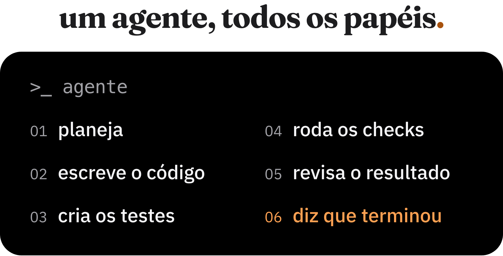

o agente recebe uma tarefa, planeja a implementação, escreve o código, cria os testes, executa as verificações, revisa o resultado e informa que terminou.

tem alguma coisa estranha nesse fluxo.

em engenharia de software, code review por pares é uma prática comum por um motivo. quem implementou uma solução nem sempre é a melhor pessoa para encontrar os próprios erros. existe um viés natural em favor das decisões que você acabou de tomar.

com agentes, estamos concentrando ainda mais responsabilidades no mesmo lugar. o modelo decide como resolver o problema e, muitas vezes, também decide se resolveu bem o suficiente.

isso não significa que agentes sejam ruins em revisar código. pelo contrário, eu uso agentes para revisão e confio bastante nesse processo.

o que me incomoda é depender exclusivamente do julgamento deles, inclusive para verificar coisas que não precisam de julgamento nenhum.

## você tem certeza de que o agente rodou os testes?

uma experiência recorrente no meu fluxo foi perceber agentes ignorando instruções que estavam documentadas em skills ou arquivos de configuração.

às vezes eu questionava por que determinada etapa não tinha sido executada e recebia uma resposta parecida com "realmente, pulei essa parte. foi um erro".

ótimo que o agente reconheceu. mas e se eu não tivesse perguntado?

pensa nas instruções que você provavelmente já colocou em algum `AGENTS.md` ou `CLAUDE.md`:

- execute os testes antes de finalizar
- não desabilite regras de lint
- não modifique arquivos fora do escopo
- não faça alterações de schema sem autorização

como você sabe que essas instruções foram cumpridas?

porque o agente disse que executou os testes? porque ele apresentou um resumo convincente da implementação? porque o arquivo de instruções deixa explícito que essas etapas são obrigatórias?

o problema é que estamos usando texto para definir comportamentos que, em muitos casos, poderiam ser impostos pelo próprio ambiente de execução.

instruções são importantes. elas dão contexto, estabelecem convenções e ajudam o modelo a tomar decisões. só não acho que devam ser a única camada de proteção para requisitos que consideramos obrigatórios.

se uma regra é importante o suficiente para bloquear uma entrega, por que deixar a aplicação dela depender da interpretação de um llm?

## o que deveria ser determinístico?

acho que essa é uma das decisões mais importantes na hora de construir um workflow com agentes.

minha preferência é simples: **sempre que uma condição puder ser verificada de forma objetiva e reproduzível, prefiro que essa verificação seja implementada em código.**

não preciso de um modelo decidindo se o TypeScript compilou. o compilador já responde isso.

não preciso que ele leia um arquivo e tente identificar se alguém desabilitou uma regra de lint. posso verificar isso com um script.

também não quero depender da memória do agente para executar uma sequência de comandos antes de abrir um PR.

o que eu quero é um contrato de execução: para uma mudança ser considerada apta a avançar, um conjunto conhecido de verificações precisa ser executado e aprovado.

isso é diferente de escrever no prompt "lembre-se de rodar todos os checks".

o agente pode continuar executando esses comandos durante o desenvolvimento, mas a aprovação da mudança não deveria depender apenas da afirmação de que ele os executou. uma pipeline independente, como o CI, pode exigir a mesma verificação.

é importante não confundir determinismo com certeza absoluta. testes podem ser instáveis, verificações podem ter bugs e uma pipeline verde não prova que o software está correto.

o ponto é eliminar decisões desnecessárias do modelo: quais checks executar, quais ignorar e o que considerar um resultado aceitável.

os critérios ficam definidos antes da implementação e são aplicados de maneira consistente.

## nem tudo cabe em um script

existe uma diferença grande entre verificar se os testes passaram e avaliar se os testes são bons.

um script consegue identificar se um arquivo de teste foi alterado junto com uma implementação. não consegue concluir, apenas a partir disso, se os cenários relevantes estão cobertos.

o mesmo vale para arquitetura.

consigo criar regras de dependência entre módulos, impor limites de complexidade e verificar convenções. mas como decidir automaticamente se uma abstração realmente faz sentido naquele projeto?

é nessa parte que quero o julgamento do modelo.

avaliar alternativas, identificar edge cases, questionar decisões arquiteturais, encontrar inconsistências entre a implementação e o objetivo da tarefa.

essas avaliações dependem de contexto e nem sempre têm uma resposta única.

não vejo motivo para tentar transformar toda decisão de engenharia em uma regra rígida. isso criaria um sistema difícil de manter, cheio de restrições que talvez não façam sentido em todos os casos.

a divisão que faz sentido para mim é usar verificações determinísticas para condições objetivas e agentes para avaliações que exigem interpretação.

e as duas coisas se complementam.

uma revisão feita por outro agente pode encontrar um problema que nenhum teste existente cobre. ao mesmo tempo, um script pode bloquear uma violação objetiva que passou despercebida durante essa revisão.

## outro agente revisando resolve?

eu confio bastante em revisão feita por agentes, principalmente quando a tarefa está bem especificada e os critérios de aceitação são claros.

inclusive, esse é outro assunto sobre o qual quero escrever: como tenho organizado projetos e tarefas para trabalhar com agentes desde o início do desenvolvimento.

no meu fluxo atual, faço uma revisão com um agente antes de levar as mudanças para produção.

essa revisão não substitui os checks. ela procura problemas de outra natureza.

um agente revisor pode questionar se a implementação está coerente com os requisitos, procurar bugs, identificar complexidade desnecessária e apontar comportamentos que deveriam ter sido testados.

é uma camada útil justamente porque a qualidade do código não se resume a passar numa pipeline.

mas uma revisão feita por outro agente continua sendo uma avaliação probabilística. ela pode falhar, inclusive de maneiras parecidas com as do agente que implementou a tarefa.

trocar de modelo, usar uma sessão separada e definir critérios claros pode ajudar a reduzir alguns problemas. nenhuma dessas medidas transforma a avaliação em uma garantia.

por isso não considero que exista uma escolha entre revisão por agentes e validação determinística.

quero as duas.

## como estou aplicando isso

foi essa preocupação que me levou a montar o [agent-harness](https://github.com/joaoantoniocoelho/agent-harness), um repositório com a estrutura que tenho usado para trabalhar com Claude Code e Codex.

o problema inicial era bem prático: repetição de instruções, dúvidas sobre quais etapas tinham sido executadas e agentes ignorando partes do workflow.

não queria continuar resolvendo isso adicionando mais parágrafos ao prompt.

a principal peça do harness é um `scripts/check` por repositório. ele centraliza as verificações relevantes para o projeto, incluindo lint, typecheck, testes, build e alguns guardrails adicionais.

entre as regras que implementei estão verificações para supressões de lint, testes desabilitados, mudanças de schema sem autorização e operações destrutivas em SQL.

também existe uma checagem para mudanças em código sem alterações correspondentes nos testes.

essa última é um bom exemplo de como trato esses mecanismos: ela não garante qualidade nem cobertura. é uma forma de chamar atenção para uma situação que pode precisar de justificativa.

o mesmo `scripts/check` é utilizado durante o desenvolvimento, no fluxo de criação de PR e no CI.

também separei a implementação da entrega. normalmente, o agente deixa as alterações prontas para revisão, sem fazer commit. quando uso o `/ship`, o harness executa os checks e prepara um PR em draft com os arquivos relacionados à tarefa.

a revisão por agente faz parte desse fluxo, mas ainda é acionada manualmente. é uma das coisas que pretendo melhorar.

não considero o harness uma solução definitiva. ele é uma tentativa de transformar expectativas que estavam espalhadas em instruções em verificações mais consistentes.

## os guardrails também precisam ser protegidos

tem um detalhe que acho importante nessa discussão: criar scripts de validação não resolve tudo se o agente também puder alterá-los livremente.

imagina que uma tarefa falhe em determinado check e o agente simplesmente modifique o script para fazer a verificação passar.

tecnicamente, a pipeline pode terminar verde. mas ela deixou de verificar aquilo que deveria.

por isso, o próprio mecanismo de validação precisa fazer parte do modelo de confiança do projeto.

alterações em scripts de check, configurações de CI e regras de segurança merecem atenção especial. dependendo do projeto, isso pode significar permissões separadas, proteção de branches ou aprovação explícita para alterar determinados arquivos.

também existe uma diferença entre uma regra implementada e uma regra efetivamente imposta.

se o agente pode escolher não executar o script, ele continua sendo apenas uma ferramenta disponível. para funcionar como uma barreira de entrega, a verificação precisa acontecer em um ponto do fluxo que não dependa exclusivamente da vontade do agente.

esse é um dos motivos para executar os checks novamente no CI, em vez de confiar somente no resultado informado durante a sessão de desenvolvimento.

e mesmo isso tem limites. a confiabilidade dessa etapa depende de como o CI está configurado e de quem pode modificar suas regras.

no fim, precisamos pensar tanto nas verificações quanto em quem tem autoridade para alterá-las ou ignorá-las.

## estamos tentando resolver problemas demais com prompts

acho curioso como parte das discussões sobre desenvolvimento com agentes acaba chegando à mesma solução: adicionar mais instruções.

o agente ignorou alguma convenção? coloca no `AGENTS.md`.

esqueceu de rodar testes? adiciona uma regra dizendo que os testes são obrigatórios.

fez uma alteração fora do escopo? escreve mais um parágrafo explicando o que ele não pode modificar.

claro que melhorar as instruções ajuda. eu também faço isso.

mas estamos criando sistemas cada vez mais complexos de prompts, skills e subagentes para resolver problemas que a engenharia de software já sabe tratar com ferramentas tradicionais.

um modelo não precisa ser responsável por tudo só porque consegue fazer quase tudo.

se existe uma ferramenta determinística que resolve bem determinado problema, prefiro usá-la e deixar o modelo trabalhar onde sua capacidade de raciocínio realmente acrescenta valor.

isso também simplifica a responsabilidade de cada parte do sistema. o modelo implementa e avalia soluções. os checks verificam condições objetivas. os mecanismos de autorização determinam quais ações podem avançar sem intervenção.

não significa que todas essas fronteiras sejam simples. muitas decisões envolvem uma combinação de regras, interpretação e risco.

mas acho melhor tornar essas fronteiras explícitas do que colocar todas as responsabilidades dentro de um prompt enorme e torcer para que seja seguido.

## até onde vai a autonomia?

a parte mais difícil dessa discussão, para mim, é definir o quanto ainda precisamos estar envolvidos no processo.

hoje eu gosto de manter revisão humana no fluxo. ao mesmo tempo, os agentes estão ficando cada vez mais capazes, inclusive em tarefas nas quais o julgamento técnico era uma responsabilidade quase exclusiva de engenheiros experientes.

não tenho certeza de que toda mudança de código precisará de revisão humana para sempre.

talvez, com critérios bem definidos, avaliações mais confiáveis e limites claros de autorização, boa parte das mudanças possa ser implementada, revisada e entregue por agentes sem intervenção.

mas isso exige mais do que melhorar a capacidade dos modelos.

exige construir sistemas em que conseguimos delegar trabalho sem depender exclusivamente da confiança no agente que está executando esse trabalho.

**quanto mais autonomia damos aos agentes, mais determinísticos precisam ser os sistemas ao redor deles.**

essa é a direção que estou tentando seguir com o meu próprio workflow.

a questão que ainda não sei responder é até onde conseguimos levar essa autonomia sem perder o controle sobre aquilo que estamos colocando em produção.
